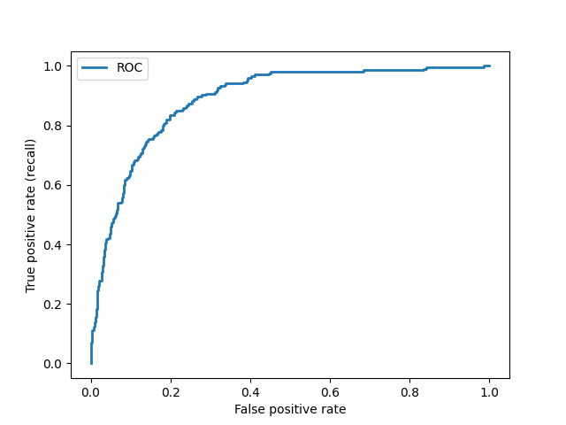
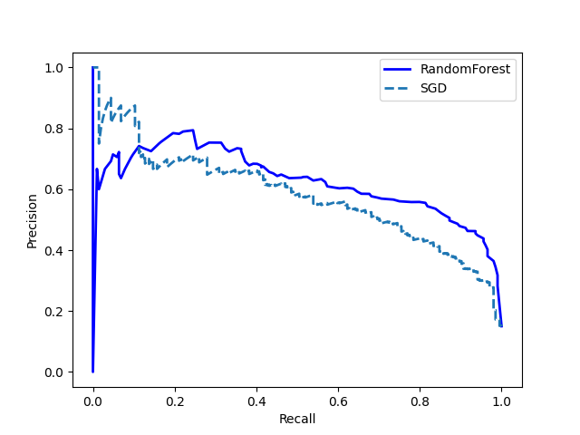

# F1 Race Predictor

A self-test of what I learned from Part I of Aurélien Géron's *Hands-On Machine Learning*,
and a coding refresher after some time away.

Using race and qualifying data from [FastF1](https://github.com/theOehrly/Fast-F1), it predicts:
- **finishing position** (regression: LinearRegression, DecisionTree, RandomForest)
- **podium finish** (classification: SGD, RandomForest)

Trained on the 2022–2024 seasons and tested on 2025.

## Results (2025 season, held out)

| Task | Naive baseline | Model |
|---|---|---|
| Finishing position, RMSE (positions) | 4.81 (finish = grid position) | **4.28** (LinearRegression) |
| Podium, F1 | **0.75** (podium = started top 3) | 0.66 (RandomForest, balanced, threshold 0.3) |
| Podium, precision / recall | 0.75 / 0.75 | 0.59 / 0.75 |

The regressor beats the "finish where you started" baseline by about half a position per driver.
The podium classifier does not beat its baseline: both catch the same 54 of 72 podiums, but the
model makes 19 extra false positives. In this data, qualifying position carries almost all of the
podium signal.

## Plots

**Precision and recall vs threshold (SGD)**

How precision and recall trade off as the decision threshold moves. This plot is used to pick a threshold.

**ROC curve (SGD)**

AUC ≈ 0.89. It looks strong, but ROC flatters imbalanced data, and only about 15% of results are podiums.

**Precision–recall: RandomForest vs SGD**

RandomForest stays above SGD for most recall values, which is why it's the final classifier.

## Run
    python extract_enrich.py        # download and build the dataset
    python classical_f1_predictor.py
